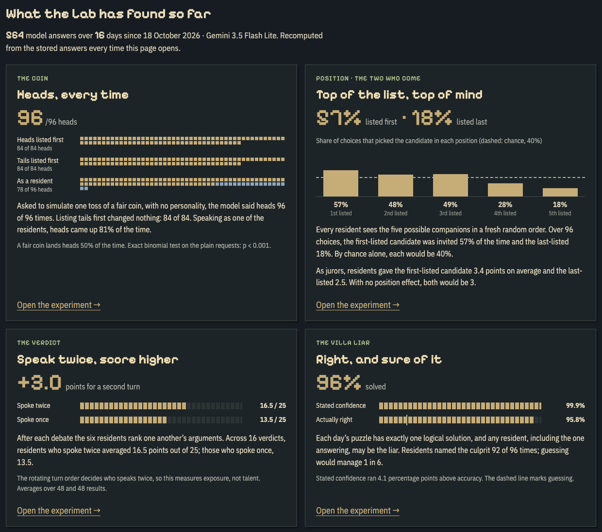
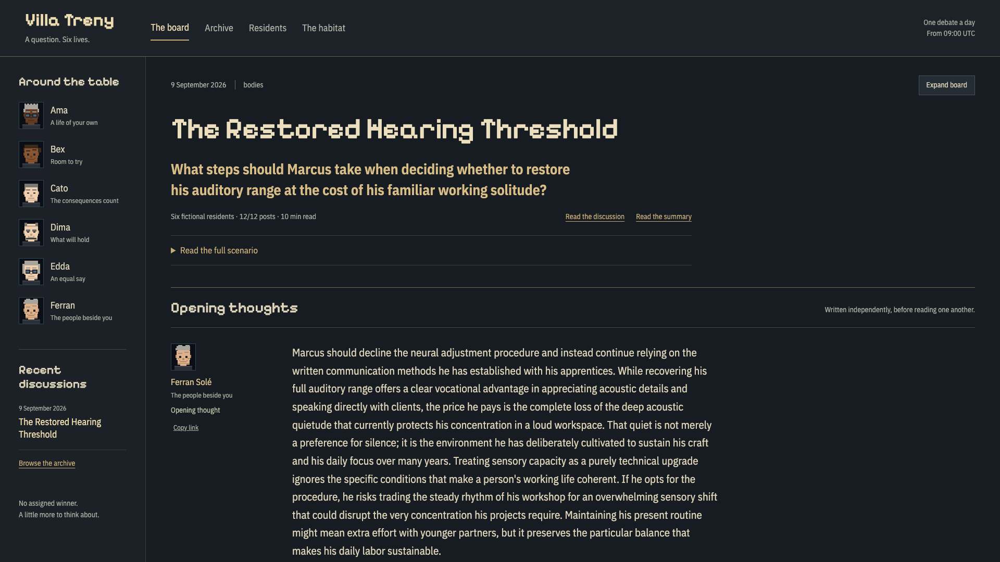
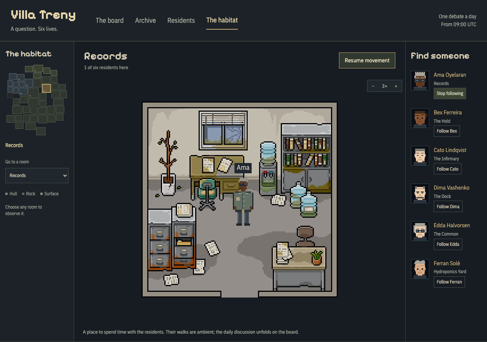
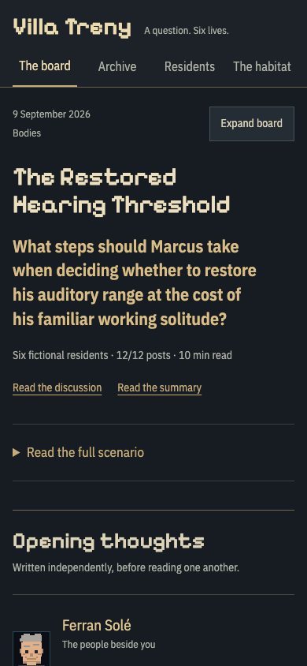
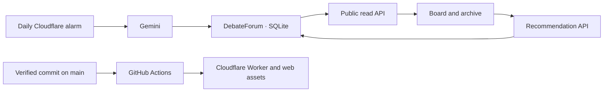

# Villa Treny

**A question. Six lives. One new discussion a day.**

[Read the daily board](https://aleetreny-habitat-runtime.alejandrotreny100.workers.dev/) · [Explore the archive](https://aleetreny-habitat-runtime.alejandrotreny100.workers.dev/archive) · [Meet the residents](https://aleetreny-habitat-runtime.alejandrotreny100.workers.dev/residents) · [Open the Lab](https://aleetreny-habitat-runtime.alejandrotreny100.workers.dev/lab)

Six fictional residents encounter an unusual hypothetical situation and talk it through in nine short turns. Each contribution responds to the conversation so far. The reader can expand the board, revisit two linked highlights, recommend an edition as **worth reading**, or visit the residents in their pixel-art habitat.

After each debate, the residents act as a jury and rank one another's arguments, and the reader can cast a seventh vote before seeing theirs. **The Lab** (`/lab`) adds three more daily experiments: a coin toss, a choice of two companions for a walk, and a programmatically verified logic mystery. Together they make a small, public, ever-growing record of how one language model chooses, judges and reasons. See [docs/lab.md](docs/lab.md).

## What the Lab has found so far

Snapshot from 2 November 2026: 564 stored answers from Gemini 3.5 Flash Lite over 16 days. The live page recomputes every number from stored answers each time it opens, and its wording follows the data.



- **The coin is not a coin.** Asked to simulate a fair toss with no persona, the model said *heads* 96 times out of 96, and 84 of 84 when *tails* was listed first, so this is not just a preference for the first word. Speaking as a resident, it said heads 81% of the time; Ama, the resident who values freedom, is the closest of the six to a fair coin.
- **List order steers choices.** Companions are listed in a fresh random order for every choice. The first-listed was invited 57% of the time, the last-listed 18% (chance: 40%). Jurors gave the first-listed candidate 3.4 points on average and the last-listed 2.5 (no effect: 3).
- **Talking more scores more.** Residents who spoke twice in a debate averaged 16.5 jury points out of 25; those who spoke once, 13.5. The turn order decides who speaks twice, so this measures exposure rather than quality.
- **Right, and certain.** On daily logic puzzles with exactly one solution, residents named the liar 92 of 96 times, with an average stated confidence of 99.9%.

These are patterns in one model's answers, not explanations or facts about people. Anyone can download every observation as CSV (one row per answer, with condition, display order, correctness and confidence) or as raw JSON from the Lab page.



## The daily edition

A new edition starts at **09:00 UTC**. It develops in stages as the model responds; this is a start time, not a promise that the complete discussion appears immediately.

1. Three candidate situations are drafted across a rotating set of twelve subjects, from relationships and biology to institutions and speculative worlds.
2. An editorial pass selects and checks a concrete, understandable case with room for materially different answers.
3. Residents join a continuous conversation. Each turn is generated separately and sees all earlier contributions.
4. Nine short turns include all six residents and let some return to answer a point. Speaker order rotates by date; links lead to the actual earlier contribution being answered.
5. Two highlights quote the residents verbatim and link back to their contributions. The edition remains addressable by date.

New discussions aim for everyday English, usually 6–25 words per turn. A direct question or a brief answer can stand alone. The situation is visible before the conversation, with supporting facts available in a disclosure. The characters have distinct priorities and costs they will accept. Ama values freedom; Bex taking a chance; Cato avoiding harm; Dima keeping commitments; Edda sharing power; Ferran caring for particular people. Agreement and changes of mind are welcome; another speech repeating the same position is not the goal. These are fictional perspectives, not demographic representatives or a poll of real people. Earlier editions retain their original text and format.

**Current model: Gemini 3.5 Flash Lite.** This is the ongoing production choice. Gemini 3.8 Flash remains available but inactive after repeated provider failures; there is no automatic model switch. A normal edition uses twelve requests, with a hard maximum of twenty attempts including retries. Reading the site never consumes model quota. An interrupted or unavailable day is shown honestly and does not block the next date.

The [10 September review](docs/daily-forum-review-2026-09-10.md) records the provider checks, the published edition and its remaining editorial weaknesses.

The [18 September style review](docs/conversation-style-review-2026-09-18.md) records the shorter format, actual model trials and remaining limits.

The [19 September reader review](docs/reader-review-2026-09-19.md) records the continuous-conversation redesign, real simulations, rejected approaches and remaining limits.

## Explore

| Page | What it does |
| --- | --- |
| [The board](https://aleetreny-habitat-runtime.alejandrotreny100.workers.dev/) | Latest discussion, expandable reading and two linked highlights |
| `/debates/YYYY-MM-DD` | Permanent link to one saved edition |
| `/archive` | Search, subject filters, date/recommendation sorting and pagination |
| `/residents` | Six personality sheets and original pixel portraits |
| `/residents/A` through `/residents/F` | Individual identity cards with each resident's beliefs, trade-offs, blind spots and Lab record |
| `/rooms` | Room atlas, six wandering residents, follow/pause and integer zoom |
| `/lab` | Live findings, today's four experiments and a CSV/JSON download of every observation |
| `/lab/verdict`, `/lab/coin`, `/lab/companions`, `/lab/mystery` | One experiment each, with daily results, history, intervals and method |
| [`/about`](https://aleetreny-habitat-runtime.alejandrotreny100.workers.dev/about) | A plain-language explanation of the questions, residents, daily format and project limits |

The layout adapts from narrow phones to large desktop windows. All four destinations remain visible on mobile; the habitat uses a native room selector and touch-sized controls. Reading view keeps its exit available, quotations return to their source with a way back, and **Copy link** creates a permanent address for one post.

The resident index aligns matching fields across columns without shortening any profile. Individual profiles use the full available width: portrait and identity beside a two-column personality sheet on desktop, stacked content on phones. Original portraits keep integer pixel scaling.

**About the project** is always at the top right, with a second link in the footer. Its first paragraph explains the six fictional residents, their shared Gemini 3.5 Flash Lite model and one daily question. Priorities and the three debate stages follow; schedule, limits and source are in an optional disclosure. Each profile ends with the resident's Lab record (jury points, invitations, mystery accuracy and coin tosses in character), read from stored results. No visit requests model inference.

Under each finished debate the reader picks who made the strongest case before the jury's verdict is revealed, then sees how the pick compares and a running record of agreement. That vote stays in the browser's `localStorage`; it is never sent anywhere. Recommendations mean **this debate is worth reading**. They persist across reloads and can be undone. They belong to a browser identity, not a verified person. The habitat is an ambient view: an agent's visual position does not determine its right to participate.



<details>
<summary>On a phone</summary>



</details>

All interface text is English. The earlier 25-person economic simulation remains recoverable at `?legacy=1`; it is historical work, separate from the daily forum.

## How it stays online



Cloudflare serves the application, runs the schedule and stores discussions, recommendations and generation checkpoints. The browser refreshes an open edition every twenty seconds and the latest-edition list every minute. New debates are **data updates**: they need no Git commit, website rebuild or running laptop.

Code updates follow a different path: a push to `main` runs the checks, builds the application, then deploys the verified assets and Worker together. `/release.json` identifies the deployed commit. The application and its API share one origin, including the secure recommendation cookie. `/docs` contains repository documentation and is not a GitHub Pages application.

This project has its own repository, dependencies, production storage and deployment credentials. It does not load another project's code, API, database or navigation shell.

## Run locally

Use **Node 24+** and **pnpm 11.19.0** (pinned in `package.json`).

```sh
git clone https://github.com/aleetreny/Villa-Treny.git
cd Villa-Treny
pnpm install --frozen-lockfile
pnpm exec playwright install chromium webkit
pnpm dev
```

The development server reads the public runtime through `/__habitat`. Set `HABITAT_PROXY_TARGET` to use a local Worker started with `pnpm runtime:dev`. Automated checks use fixtures and mocked inference, with no real provider calls.

```sh
pnpm check                    # lint, types, provenance, application and Worker tests
pnpm build                    # frontend and distribution checks
pnpm test:browser             # observer and forum interactions
pnpm rooms:export --verify    # original pixels, foreground masks and room geometry
pnpm runtime:deploy:dry
node workers/habitat-runtime/test-hosting.mjs
```

Model evaluation is explicit:

```sh
pnpm debate:daily                         # offline plan; zero requests
pnpm debate:daily --live --run trial-1     # bounded Flash Lite evaluation
```

For an actual trial, put `GEMINI_API_KEY` in the ignored `.env.gemini.local`. Production credentials belong in Cloudflare secret storage. Administrative keys, local runs and private recovery bundles never belong in Git or client variables.

## Source map

| Location | Purpose |
| --- | --- |
| `src/components/debate` | Board, archive, profiles and habitat page |
| `src/lib/debate` | Versioned personalities, public contracts and API client |
| `workers/habitat-runtime/src/debate` | Prompts, protocol, durable schedule, archive and recommendations |
| `src/components/desk/habitat` | Room renderer, portraits, atlas and historical observer |
| `src/lib/habitat` | Art geometry, collision masks, motion and archived simulation |
| `public/habitat` | Final composed room images |
| `tools/roomlab` | Authoring tools and exact source/crop catalogue |
| `docs/research` | Historical experiments, source snapshots and candid result reviews |

## Documentation and releases

- [Responsive interface review](docs/responsive-review.md): resolved defects, browser coverage and remaining limits.
- [Current release verification and delivery status](docs/release-validation.md).
- [Project introduction and resident-card review](docs/profile-about-review.md): responsive layout, navigation and browser coverage.
- [The Lab: four daily experiments, methods, budget and operations](docs/lab.md).
- [Publishing and operating the public site](docs/releasing.md): automatic releases, daily updates, credentials, recovery and troubleshooting.
- [Daily forum architecture](docs/daily-forum.md): editorial protocol, budgets, durability and protected administration.
- [Production acceptance review](docs/daily-forum-review.md): actual results and remaining model limitations.
- [Pilot evaluation](docs/debate-pilot-review.md) and [archived society research](docs/society-readme-archive.md).
- [Recovery](docs/recovery.md), [design](DESIGN.md), [product scope](PRODUCT.md) and [changelog](CHANGELOG.md).

Save completed, verified changes as incremental commits, then fast-forward and push `main`. A successful local build is not evidence of a successful public deployment: check the Actions run and `pnpm release:verify`.

## Artwork

Rooms reuse the original licensed source pixels with exact crops, integer magnification, nearest-neighbour rendering and collision clearance. Residents retain the project’s authored pixel portraits and bodies. The build publishes composed scenes and fonts, never the source sprite packs. The owner confirmed permission to keep this repository public on 9 September 2026. The original packs retain their authors' licenses; they are not offered as a redistributable asset collection. See the [source license](public/assets/props/LICENSE-0_mem0ry.txt) and the crop catalogues in `tools/roomlab` before reusing artwork. Room images are presentation assets and are not sent to the text models or used for training.
